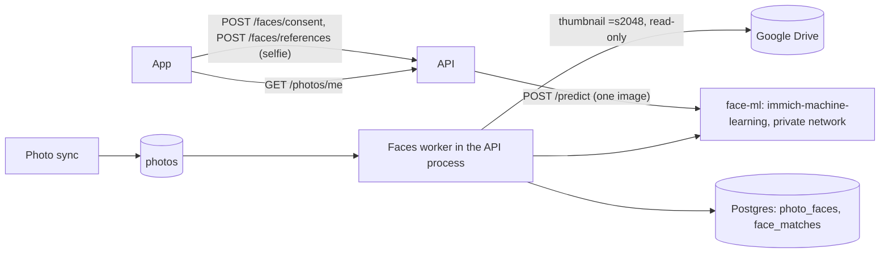

# Face recognition ("Mes photos"): operations guide

Each user who opts in sends a selfie and gets an album of the gallery photos they appear in, past and future.
Photos stay on Google Drive; only face boxes and embeddings are stored in Postgres.

## 1. How it works



- The photo sync already indexes every Drive photo into `photos`. Every 5 minutes (and right after a new
  selfie), the worker (`services/faces`) takes the eligible photos not yet scanned, newest first: same
  visibility as the gallery, images only. It downloads Drive's 2048 px rendition, sends it to `face-ml`, and
  stores the faces found (`photo_faces`). The image itself is dropped.
- Each reference (`face_references`, at most 3 per user) has a cursor (`matched_through`): a new reference
  sweeps every stored face once, then only the new ones. A face whose cosine distance to a reference is
  ≤ `FACES_MAX_DISTANCE` is recorded in `face_matches`. `GET /photos/me` lists those photos.
- One worker runs at a time across instances (Postgres advisory lock). Faces of photos that leave the gallery
  are deleted at the start of each run.

## 2. Personal data (GDPR art. 9)

| Data | Kept | Removed when |
|---|---|---|
| Selfie | never (memory only, during the request) | – |
| Reference embedding | `face_references` | consent withdrawn (`DELETE /faces`), account deleted, inactivity purge |
| Consent (version, date) | `face_consents` | same |
| Matches, "not me" | `face_matches` | same, or the photo leaves the gallery |
| Faces on photos (everyone, unnamed) | `photo_faces` | the photo is deleted, becomes a duplicate or a cover |

- No consent, no matching: matches are inserted only for users with a `face_consents` row, checked in the same
  statement.
- Only the user sees their album (`/photos/me` uses the token's email). A wrong match never exposes anything
  new: every listed photo is already in the gallery that all students can see.
- `ConsentVersion` (`services/faces/service.go`) names the text shown in the app. Changing the text means
  bumping it in both places. Users on the old version keep their album but must agree again before adding a
  selfie.
- Before launch, outside the code: an impact assessment (AIPD/DPIA, required for biometric data), an entry in the
  records of processing, and an updated privacy policy. Faces of people who have not opted in are stored
  (embeddings only, never linked to a name), so a new user's album fills in within minutes. This was a deliberate
  choice and should be recorded and justified in the AIPD.
- Model licence: InsightFace's `buffalo_l` is distributed for non-commercial use.

## 3. Deploying on Railway

The `face-ml` service runs the public image directly; nothing to build. Set up on `dev` with the Railway CLI
(from a directory linked to the target environment with `railway link --project <id> --environment <id>`):

```
railway add --service face-ml --image ghcr.io/immich-app/immich-machine-learning:v3.4.0 \
  --variables "IMMICH_HOST=::" --variables "IMMICH_PORT=3003" \
  --variables "MACHINE_LEARNING_CACHE_FOLDER=/cache" --variables "MACHINE_LEARNING_WORKERS=1" \
  --variables "MACHINE_LEARNING_MODEL_TTL=600"
railway volume --service face-ml add --mount-path /cache
railway variable set 'FACES_ML_URL=http://${{face-ml.RAILWAY_PRIVATE_DOMAIN}}:3003' \
  'FACES_SCOPE_FOLDERS=<drive folder id>' --service "Transat API"
```

- No public domain: the service is only reachable on the private network.
- The image is pinned to v3.4.0, the version the real-model test passed with. Bump it only after re-running it.
- Resources: measured ~400 MB RAM with buffalo_l loaded, 1–2 vCPU while scanning. Models (~415 MB, in the
  `/cache` volume) unload after 10 idle minutes (`MACHINE_LEARNING_MODEL_TTL`).
- API variables:
  - `FACES_ML_URL` (required, the feature is off without it);
  - `FACES_SCOPE_FOLDERS`: comma-separated Drive folder IDs; only photos in them and their sub-folders are
    scanned. Unset: the whole gallery. `dev` is limited to one test folder;
  - optional: `FACES_MAX_DISTANCE` (0.5; lower = stricter), `FACES_MIN_SCORE` (0.7),
    `FACES_SCAN_CONCURRENCY` (2), `FACES_MODEL` (`buffalo_l`).
   - It reuses `GOOGLE_DRIVE_CREDENTIALS_JSON`, the photo sync's read-only account.
- Deploy the API: migration `00052_faces.sql` creates the tables (plain Postgres, no extension needed).

Unset `FACES_ML_URL` and the feature is off: `GET /faces` answers `available: false` and the app hides it.

### Cost and throughput (estimates, measure after the first run)

- Throughput on CPU: about 0.3 s per photo measured on a laptop (18 photos in 5.5 s, models loaded), expect
  0.5–1 s on 1–2 Railway vCPU, plus the Drive download. The first pass over the archive
  (e.g. 50,000 photos) takes several hours to about a day; new events are processed within minutes.
- Matching is done in Go: 2 KiB per face. A new reference reads every stored face once (100,000 faces ≈ 200 MB
  streamed, a few seconds), then only new faces.
- Railway bills RAM and CPU by usage: with models unloaded when idle, expect a few dollars to ~20 $/month.

## 4. API

| Method | Path | |
|---|---|---|
| GET | `/faces` | status: available, enabled, consent version (current and agreed), references, matching in progress, photo count, library progress |
| POST | `/faces/consent` | `{"version": "<ConsentVersion>", "accepted": true}` |
| POST | `/faces/references` | multipart `photo` (JPEG/PNG ≤ 10 MB). 422 `no_face`, `multiple_faces`, `face_too_small`; 409 `too_many_references`, `consent_outdated`; 403 `consent_required`; 10 tries/hour |
| DELETE | `/faces` | withdraw consent and erase every face data of the user |
| POST | `/faces/photos/:id/reject` | "not me" |
| GET | `/photos/me?cursor=&limit=` | the album, same page format as `/photos` |

## 5. Testing

```
TRANSAT_TEST_DSN="host=localhost port=54329 user=postgres password=pg dbname=transat_test sslmode=disable" \
  go test -race ./services/faces/ ./handlers/faces/
```

Against the real model (macOS, needs `sips`), with a folder of single-person portraits that is never committed:

```
docker run -d --rm --name face-ml-test -p 3003:3003 ghcr.io/immich-app/immich-machine-learning:v3.4.0
FACES_ML_TEST_URL=http://localhost:3003 FACES_TEST_IMAGES=/path/to/portraits TRANSAT_TEST_DSN=... \
  go test -v -run TestRealModel ./services/faces/
```

It checks the request format, that each portrait is accepted as a selfie, that derived shots (mirrored, smaller,
tilted) stay under the threshold while different people stay above it, and that only consenting people get an album.
Measured with v3.4.0 on 6 portraits: same person ≤ 0.10, different people ≥ 0.84. Derived shots are easier than real
event photos (other day, angle, light), so check `FACES_MAX_DISTANCE` on real albums before launch.
