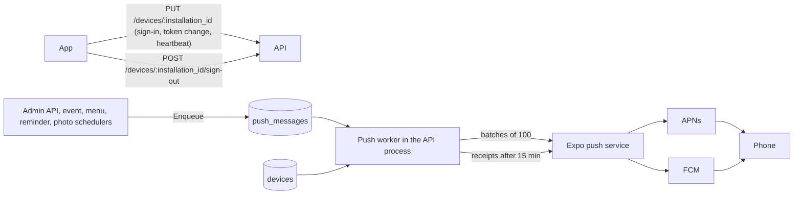

# Push notifications: operations guide

This describes what is deployed, how to configure it, how to test it and how to take it back. It matches the code
of `transat-backend` (Go) and `transat-app` (Expo). No secret appears here: every credential is named, never shown.

## 1. How it works



- **One row per installation** in `devices` (`installation_id` is generated by the app and survives logout). The
  row is owned by whoever is signed in; a second account on the same phone takes it over. A push token belongs to
  one installation at most.
- **Presence is computed, never stored.** `last_seen_at` is refreshed by every authenticated registration call (the
  app sends one at sign-in, on token change and every `heartbeat_interval_seconds` while open). States: `connected`
  (proof within 10 min), `active` (valid session, app in background or closed), `expired` (no proof for 60 days),
  `revoked` (older than the last password change), `disabled` (signed out, token replaced or token invalid). Only
  `connected` and `active` devices with a token and a permission that is not `denied` are pushed to.
- **A message is stored, not sent, by the request that creates it** (`push_messages`). The worker fans it out into
  one `push_deliveries` row per eligible device, **checks every device again right before sending** (owner,
  state, token, category preference, message deadline), sends in batches, retries transient failures with a bounded
  exponential backoff, deactivates a token only when Expo or the receipt says it is dead, reads receipts later and
  marks the message completed.
- **Duplicates:** a message with the same `dedupe_key` is queued once; a delivery is unique per message and device;
  workers claim rows with `FOR UPDATE SKIP LOCKED` under a lease; every push of a message carries the same collapse
  key (iOS `collapseId`, Android `tag`), so a resend replaces the notification on the phone.
- **Payload** (`data`): `type` (what produced it), `navigation` `{v, type, id, params}` (stable entity id, never a
  name or a link), `screen` (only for app versions older than navigation). Optional image: `richContent.image`,
  plus `mutableContent` on iOS only. Title and body are localized per device language. The app re-checks access to
  the destination with the user's own session: a payload never grants access.

## 2. Configuration

### Backend environment variables

Everything is optional unless marked required. Durations are Go durations (`30s`, `15m`, `720h`). An invalid value is
ignored with a warning in the log and the default is used.

| Variable | Default | Purpose |
| --- | --- | --- |
| `PUSH_PIPELINE` | worker on | `legacy` sends straight from the request/scheduler without the worker (rollback switch) |
| `EXPO_ACCESS_TOKEN` | none | Expo access token. **Secret.** Required only when "enhanced push security" is enabled in the Expo project; without it Expo answers `UNAUTHORIZED` and nothing is delivered |
| `PUSH_POLL_INTERVAL` | `5s` | How often the worker looks for work when nothing wakes it |
| `PUSH_BATCH_SIZE` | `100` | Messages per Expo request (Expo allows 100) |
| `PUSH_MAX_ATTEMPTS` | `5` | Tries per delivery, the first included |
| `PUSH_RETRY_BASE` / `PUSH_RETRY_MAX` | `30s` / `15m` | Bounds of the backoff; `PUSH_RETRY_MAX` below the base resets both |
| `PUSH_LEASE` | `2m` | How long a worker owns claimed deliveries; a crashed worker's claims return after it |
| `PUSH_DEFAULT_TTL` | `2h` | Lifetime of a message whose sender gives no deadline; also the TTL given to APNs/FCM |
| `PUSH_RECEIPT_DELAY` | `15m` | Wait before asking Expo for a receipt |
| `PUSH_MAX_PER_SECOND` | `300` | Rate handed to Expo (Expo's limit is 600); `0` disables the cap |
| `PUSH_RETENTION` | `720h` | How long finished messages and their delivery log are kept |
| `DEVICE_SESSION_TIMEOUT` | `1440h` | No proof for this long = `expired` |
| `DEVICE_PRESENCE_WINDOW` | `10m` | Proof this recent = `connected` |
| `DEVICE_HEARTBEAT_INTERVAL` | `5m` | Returned to the app; must be at most half the presence window |
| `DEVICE_WRITE_THROTTLE` | `1m` | Shortest time between two writes for an unchanged installation; shorter than the heartbeat |
| `R2_PUBLIC_DOMAIN` | required (existing) | Event posters are attached as notification images only when hosted on this host |
| `PHOTOS_ALBUM_NOTIFICATIONS` | on | `off` stops new-album notifications without touching the photo sync |
| `DB_*`, `JWT_SECRET`, `ENV`, `ALLOWED_ORIGINS` | required (existing) | unchanged |

An inconsistent `DEVICE_*` set falls back to the defaults for all four. `.env.sample` does not list the new
variables (editor tools could not modify it): paste the table above into it as commented lines.

### Provider credentials (none in the repository)

- **Android (FCM):** an FCM V1 service account key uploaded to the Expo project (`eas credentials`, Android,
  Google Service Account Key for Push Notifications). `google-services.json` in `transat-app` is the Firebase *client*
  configuration; its sender must match the service account's project.
- **iOS (APNs):** an APNs key managed by EAS (`eas credentials`, iOS, Push Notifications). The build's
  `aps-environment` is `production` for the production profile (verified from an exported IPA).
- **Expo:** the project id is in `transat-app/app.json` (`extra.eas.projectId`); `EXPO_ACCESS_TOKEN` only if push
  security is enabled.
- **iOS notification service extension (images):** a second App ID, `fr.resel.transat.notification-service`, with its
  own App Store provisioning profile. `eas build` creates both interactively on the first iOS build after this change
  (it needs your Apple account). `ios.appleTeamId` is not set in `app.json`; prebuild prints a warning, EAS fills the
  team in from the credentials.

## 3. Database migrations

Applied automatically, in order, by `goose.Up` when the API starts (`db/migrations`, relative to the working
directory). Every one is additive: the previous server version keeps working on the new schema.

| # | File | What it does |
| --- | --- | --- |
| 00037 | `devices` | `devices` table, unique token index, `ON DELETE CASCADE` from `newf` |
| 00038 | `devices_legacy_tokens` | `source` column, `unknown` platform, `invalid_token` reason; imports every well-formed row of `user_notification_tokens` as a `legacy` device (a token shared by two accounts goes to the most recent) |
| 00039 | `push_pipeline` | `push_messages` and `push_deliveries` |
| 00040 | `push_message_image` | nullable `push_messages.image_url` |
| 00041 | `reservation_reminders_waitlist` | `reservation.created_at`, `reservation_reminders` (one row per reminder sent), `reservation_waitlist` (queue of interest) |
| 00042 | `push_message_action_category` | nullable `push_messages.action_category` (interactive notification buttons) |

`user_notification_tokens` is still written (mirrored from `devices`) and still read by `PUSH_PIPELINE=legacy`.
`TestNotificationMigrationsUpgradeKeepTheLegacyTokensAndCanBeRolledBack` upgrades a database holding legacy
tokens, rolls back to 00036, and upgrades again.

## 4. Native apps and rebuilds

No OTA update mechanism is installed: every change below ships through a new store build.

| Change | iOS | Android |
| --- | --- | --- |
| `expo-crypto` (installation id) | native module: rebuild | native module: rebuild |
| Notification service extension (`targets/notification-service`, `@bacons/apple-targets`) | new target and App ID: rebuild + credentials | not applicable |
| Everything else (registration, lifecycle, tap navigation) | JS only | JS only |

Configuration that matters, and where it comes from:

- Android: `POST_NOTIFICATIONS`, `RECEIVE_BOOT_COMPLETED`, the FCM service and the default icon/colour come from the
  `expo-notifications` plugin and are present in the built manifest. The channel `default` is created at runtime on
  every registration (pushes name it; Android drops a push for a channel that does not exist).
- iOS: push entitlement from EAS; no `UIBackgroundModes` (visible pushes do not need it).
- A development client built before this change cannot run the new JavaScript (`expo-crypto` is missing): rebuild it.
- The permission prompt appears once, after onboarding, and is never repeated for a user who refused; the refusal
  is remembered across logout. A user who refused re-enables notifications in the system settings (the app links to
  them).

## 5. Railway

- No new service, no new process, no Procfile or start command change. The API process runs the HTTP server, the
  push worker, the event/menu schedulers and the cron jobs (photo sync, report delivery).
- Several replicas are safe: the worker, the fan-out and the receipts use row locks and leases; messages are
  deduplicated by key.
- Set the variables of section 2 in the service variables (`EXPO_ACCESS_TOKEN` as a secret). Defaults are fine to
  start with.
- The first deploy runs migrations 00037 to 00040 at boot; check the log for `Database migrations completed
  successfully` and `push.worker_started`.
- Watch the structured log lines of the worker: `push.created`, `push.fanout`, `push.attempt`, `push.receipts`,
  `push.completed`, `push.device_invalidated`, `push.cancelled`, `push.provider_credentials`. They carry counts and
  codes, never a token or a message text.
- Sign-out (`POST /devices/:installation_id/sign-out`) is unauthenticated on purpose (it must work after the session
  ended). It is limited to 20 calls a minute per installation; the app retries a failed one later.

### Background work in the API process

| Job | Cadence | Notes |
| --- | --- | --- |
| Push worker | every `PUSH_POLL_INTERVAL`, and at once after a message is queued | fan-out, dispatch, receipts, completion |
| Purge of finished messages | hourly | older than `PUSH_RETENTION` |
| Event reminders (`scheduler/event_scheduler.go`) | periodic | queued once per event, expire at the event start |
| Restaurant menu (`scheduler/restaurant_scheduler.go`) | weekdays 9h to 14h | queued once per day |
| Photo album announcements | follows the photo sync | queued once per album |
| Reservation reminders (`scheduler/reservation_scheduler.go`) | every minute | see below |

### Reservation notifications

All of them use the `RESERVATIONS` category (a user who switched it off gets no push; the cancellation email is
independent) and are addressed to one user. They need the pipeline: with `PUSH_PIPELINE=legacy` the reminders and the
waiting list notifications are not sent.

| `data.type` | When | Notes |
| --- | --- | --- |
| `reservation_cancelled` | an administrator cancels somebody else's reservation (`DELETE /reservation/item/:id`) | names the administrator; an email with the same information goes out |
| `reservation_reminder` | one hour before a slot; one, five and seven days into a loan of an item without slot | claimed in `reservation_reminders` first, so a milestone is never sent twice; nothing for a cancelled or returned reservation, nor for a slot booked less than an hour before it starts; a milestone is dropped when it is more than 24 hours late |
| `reservation_waitlist` | a reserved item or slot is released and somebody is waiting for it | only the first reachable person of the queue; carries `categoryId = reservation_waitlist` |

The waiting list notification opens the reservation page (`navigation.params.waitlist = "1"`, plus `start` in the API's
UTC format for a slot) and expects the app to register an interactive category named `reservation_waitlist` with two
buttons: "Réserver" calls `POST /reservation/item/:id/waitlist/reserve` and "Annuler" calls
`POST /reservation/item/:id/waitlist/decline`, both with `{"start_date": "YYYY-MM-DD HH:mm:ss"}` for a slot item. An
app that did not register the category shows a plain notification that opens the page.

## 6. Send a controlled test notification

Use an administrator account (`ADMIN` role). `$API` is the API base URL and `$ADMIN_JWT` an administrator's token;
neither belongs in a file.

1. Count who would receive it, without sending (`dryRun`):

   ```sh
   curl -s -X POST "$API/admin/notifications/send" \
     -H "Authorization: Bearer $ADMIN_JWT" -H "Content-Type: application/json" \
     -d '{"title":"Test","message":"Controlled test","audience":{"type":"users","emails":["you@example.org"]},"dryRun":true}'
   ```

   The answer has `users`, `devices`, `withoutDevice` (users with no eligible device) and `filtered` (why devices were
   left out, e.g. `expired`, `disabled`, `no_token`, `permission_denied`).
2. Send it: the same body without `dryRun`, optionally with `"service":"RESTAURANT"` (applies that category's
   preference), `"navigation":{"type":"event","id":"7"}` (the screen opened on tap) and `"imageUrl":"https://..."`.
   The API answers `202` with `id`: the message is queued, nothing has been sent yet. `sent` is always `false`.
3. Follow it: `GET $API/admin/notifications/messages/<id>` (or `/admin/notifications/messages?limit=20`).
4. Always test with your own address first, on one iOS and one Android device, before sending to a wider audience.

## 7. Diagnose "I did not receive the notification"

Work from the server to the phone and stop at the first answer.

1. **Was the user in the audience?** Open the message (`/admin/notifications/messages/<id>`). `users` is the audience
   after preferences. A user who switched the category off is not counted.
2. **Did the user have an eligible device at fan-out?** `filtered` counts the devices left out by reason. Check the
   user's devices:

   ```sql
   SELECT d.installation_id, d.platform, d.permission_status, d.app_version, d.push_token IS NOT NULL AS has_token,
          d.status, d.disabled_reason, d.last_seen_at,
          CASE
            WHEN d.status <> 'active' THEN 'disabled'
            WHEN GREATEST(d.last_seen_at, CASE WHEN d.source = 'legacy' THEN n.last_activity::timestamptz END) <= COALESCE(n.password_updated_date::timestamptz, '-infinity') THEN 'revoked'
            WHEN GREATEST(d.last_seen_at, CASE WHEN d.source = 'legacy' THEN n.last_activity::timestamptz END) < now() - interval '60 days' THEN 'expired'
            WHEN GREATEST(d.last_seen_at, CASE WHEN d.source = 'legacy' THEN n.last_activity::timestamptz END) >= now() - interval '10 minutes' THEN 'connected'
            ELSE 'active' END AS state
   FROM devices d JOIN newf n ON n.email = d.user_email
   WHERE d.user_email = 'user@example.org'
   ORDER BY d.last_seen_at DESC;
   ```

   No row: the app never registered (old app version, or never signed in on a build with registration; ask the user
   to update). `disabled`: signed out, token replaced by another installation, or token reported dead: opening the
   app re-registers it. `expired` or `revoked`: the user must sign in again. `permission_status = denied` or no
   token: notifications are off on the phone.
3. **What happened to each delivery?**

   ```sql
   SELECT m.id, m.kind, m.status AS message, m.created_at, d.device_id, d.status, d.attempts, d.error_code,
          d.skip_reason, d.accepted_at, d.receipt_at
   FROM push_deliveries d JOIN push_messages m ON m.id = d.message_id
   WHERE d.user_email = 'user@example.org'
   ORDER BY m.id DESC LIMIT 20;
   ```

   | Delivery status | Meaning |
   | --- | --- |
   | `skipped` (`skip_reason`) | The device stopped qualifying between fan-out and sending: `disabled`, `expired`, `revoked`, `no_token`, `permission_denied`, `owner_changed` (another account took the phone), `preference_off` |
   | `expired` | The message deadline passed before it was sent (`PUSH_DEFAULT_TTL`, or the sender's deadline) |
   | `pending` | Waiting for a retry (`error_code` says why); `retries_exhausted:<code>` in `failed` means all attempts failed |
   | `accepted`, `handed_off` | Expo, then APNs/FCM, took it. **This is the last server-side evidence there is:** no provider confirms that the phone received or showed it |
   | `failed` + `DeviceNotRegistered` | The provider says the token is dead; the device was disabled and the app registers it again when opened |
   | `failed` + `InvalidCredentials` / `MismatchSenderId` | Provider credentials (section 2): the log shows `push.provider_credentials` |
   | `failed` + `MessageTooBig` | Payload over 4 KiB (the server shrinks text to fit; a huge destination or image link is refused at queueing) |
   | `unconfirmed` | Accepted but no receipt could be read |

4. **Server-wide health:** `SELECT status, count(*) FROM push_deliveries WHERE created_at > now() - interval '1 day' GROUP BY status;`,
   stuck messages: `SELECT id, kind, status, created_at FROM push_messages WHERE status IN ('pending','fanned_out') AND created_at < now() - interval '15 minutes';`,
   error codes: `SELECT error_code, count(*) FROM push_deliveries WHERE error_code IS NOT NULL AND created_at > now() - interval '1 day' GROUP BY error_code ORDER BY 2 DESC;`.
   Many `pending` rows with a `TOO_MANY_REQUESTS` or `http_5xx` code means Expo is limiting or down: they retry on their own.
5. **The phone:** iOS Focus mode, scheduled summary, per-app setting; Android battery restrictions, the app's
   "default" channel set to silent, system notification toggle. The in-app Settings screen shows a notice when the
   phone permission is off. A tap that does nothing visible: the destination may be deleted or no longer accessible
   to the account, in which case the app opens the list and says so.
6. Old app versions (before device registration) register their token through `PATCH /newf/me`; they appear as
   `source = 'legacy'`, their session is read from the account's last activity, and they cannot be signed out
   individually.

## 8. Rollback

Order from the lightest to the heaviest. None of them needs a database restore.

- **Stop one message:** `UPDATE push_messages SET expires_at = now() WHERE id = <id>;` Deliveries not yet sent become
  `expired` at the next worker round. Pushes already accepted by Expo cannot be recalled.
- **Switch the worker off:** set `PUSH_PIPELINE=legacy` and restart. Notifications are sent straight from the request
  or scheduler to the tokens of `user_notification_tokens` (still maintained by registration and sign-out), without
  the session policy, the durable queue or the delivery log. Images and `data.type` are not sent in this mode.
- **Silence one source:** `PHOTOS_ALBUM_NOTIFICATIONS=off` for album announcements.
- **Previous server version:** redeploy it. The schema is additive and the previous version ignores the new tables.
  Registration calls from the apps then answer 404; the app treats a failed registration as non-blocking and retries
  with a backoff.
- **Database:** only if needed, `goose down-to 36` (or the equivalent in code) drops `devices`, `push_messages` and
  `push_deliveries` and keeps `user_notification_tokens`; it is tested, and `goose up` restores everything (legacy
  devices are imported again; registrations of installed apps return at the next heartbeat).
- **Apps:** a store release cannot be recalled. The notification code is defensive: a server without the endpoints,
  a refused permission, a missing token or a missing extension never blocks the app, and a push without image
  or destination is still shown as text.

## 9. Production rollout checklist

1. Credentials: FCM V1 key and APNs key present in the Expo project (`eas credentials`); decide whether Expo push
   security is on, and if so set `EXPO_ACCESS_TOKEN` in Railway.
2. Backend: merge, deploy, confirm the migration log line and `push.worker_started`. Keep `PUSH_PIPELINE` unset.
3. Send a `dryRun` then a real test to your own account (section 6): the message must reach `completed` with
   deliveries `accepted` then `handed_off`.
4. Build the apps: iOS with the new App ID and profile (first build is interactive), Android as usual. Install on a
   real iPhone and a real Android phone.
5. On each phone: sign in, finish onboarding, accept the prompt; check that `GET /devices` (or the SQL of section 7)
   shows the device `connected` with a token; send a test with an image and a destination; check it arrives in
   foreground, background and after force-closing the app, and that the tap opens the right screen.
6. Sign out on the phone: the device must become `disabled` and a new test must not reach it. Sign in with another
   account: the first account must not receive anything there.
7. Release to the stores, watch `push.*` logs and the status counts of section 7 for a day, then keep an eye on
   `unconfirmed`, `retries_exhausted` and `DeviceNotRegistered` rates.

## 10. Tests

- Backend: `TRANSAT_TEST_DSN="host=/tmp port=5432 user=postgres dbname=transat_test sslmode=disable" go test -race ./...`
  (needs a PostgreSQL database whose name contains `test`; each test works in its own schema).
- App: `npm test` (Node's test runner with mocked Expo and React Native modules) and, on a Mac with Xcode,
  `npm run test:ios-extension` (the real extension class against canned network replies).
- These tests use mocks and fake providers. They do not replace a test on real phones with real Expo, APNs and FCM
  (checklist, step 5).
